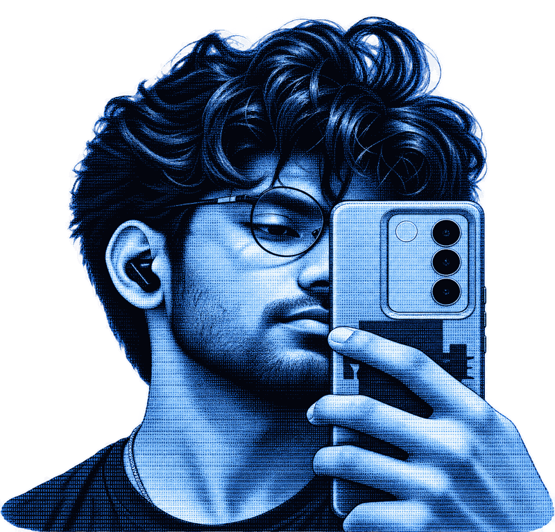

 

# Sourav S. Kamble

### Computer Science Engineer · Full-Stack Developer · AI Enthusiast

---

## About

I'm a Computer Science student interested in building practical software, full-stack applications, and AI-powered tools. I enjoy learning by building projects and improving my development skills through hands-on work.

- **Frontend:** React, JavaScript
- **Backend:** Node.js, Express
- **Database:** MongoDB
- **Languages:** Python, JavaScript

## Featured Projects

| Project | Description | Technologies |
|---|---|---|
| **LUX Restaurant Platform** | Restaurant platform with menu and booking functionality | React, Node.js, Express, MongoDB |
| **AI Assistant** | Personal assistant project exploring AI capabilities | AI, software development |
| **E-Commerce Sales Analytics** | Project focused on analyzing sales data and extracting insights | Data analytics |

## Tech Stack

## GitHub Contributions

## Portrait

  

---

*Build thoughtfully. Learn continuously. Improve with every commit.*

