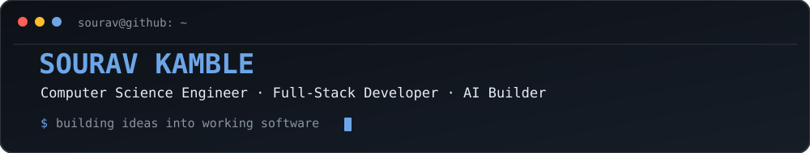
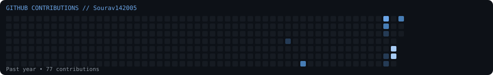
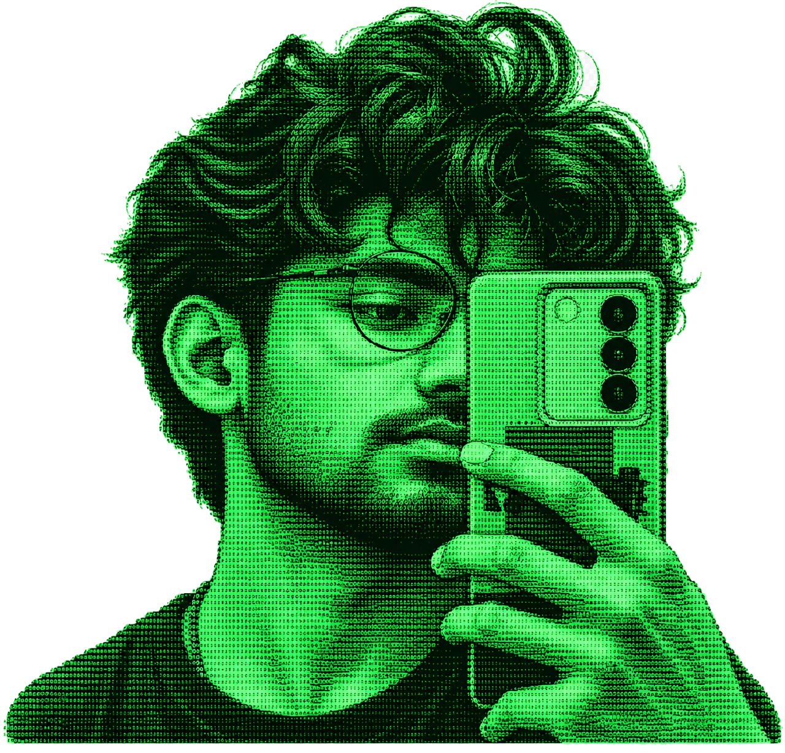

 <div align="center">



# Sourav Kamble

### Computer Science Engineer · Full-Stack Developer · AI Enthusiast



</div>

---

## `$ whoami`

```text
NAME       : Sourav Kamble
ROLE       : Computer Science Engineer
FOCUS      : Full-Stack Development & AI
FRONTEND   : React, JavaScript
BACKEND    : Node.js, Express
DATABASE   : MongoDB
LANGUAGES  : Python, JavaScript
STATUS     : Learning, building, improving
```

## `$ cat about.txt`

- 💻 Interested in full-stack development and AI-powered applications.
- 🚀 Building projects that solve practical problems.
- 🌱 Exploring modern web technologies, backend systems, and databases.

## `$ ls ~/projects`

| Project | Description |
|---|---|
| **LUX Restaurant Platform** | Restaurant platform built with React, Node.js, Express, and MongoDB |
| **AI Assistant** | Exploring AI-powered assistant capabilities |
| **E-Commerce Sales Analytics** | Data analysis and sales insights |

## `$ cat tech-stack.txt`

<div align="center">


</div>


### `$ ./terminal`

<div align="center">


<br/>


</div>

### `$ ./contribution-art`

<div align="center">



</div>

### `$ ./ascii-portrait`

<div align="center">



</div>


## `$ git status`

```text
Learning new things...
Building projects...
Committing progress...
```

<div align="center">


*Build useful things. Learn relentlessly. Improve every commit.*

</div>
